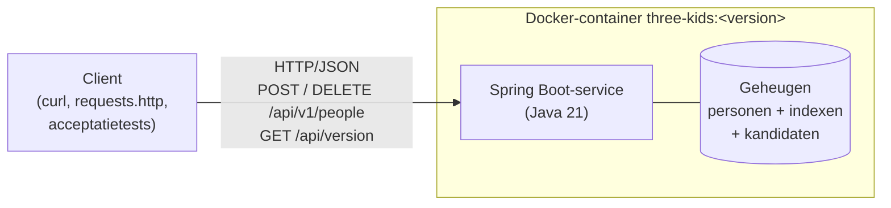
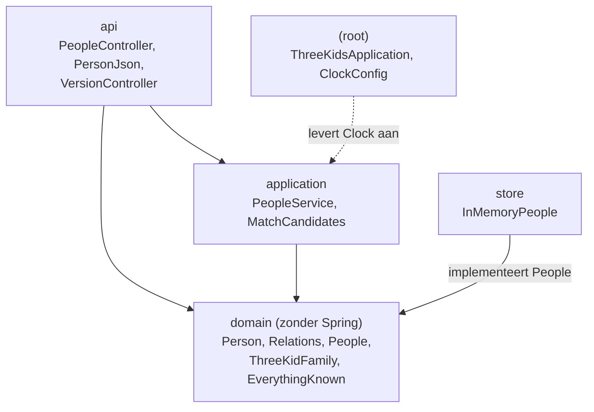
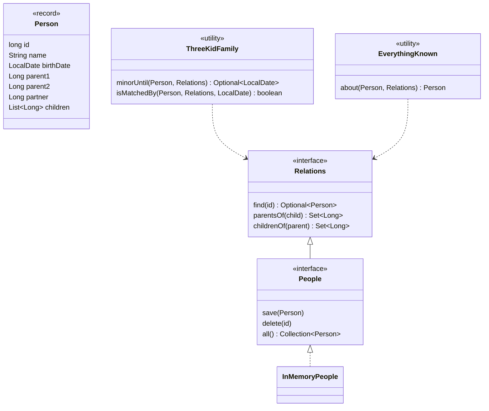
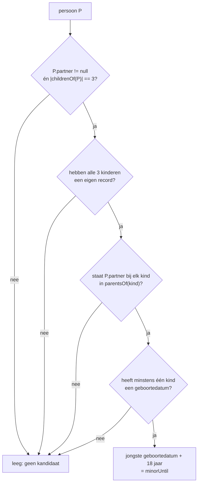
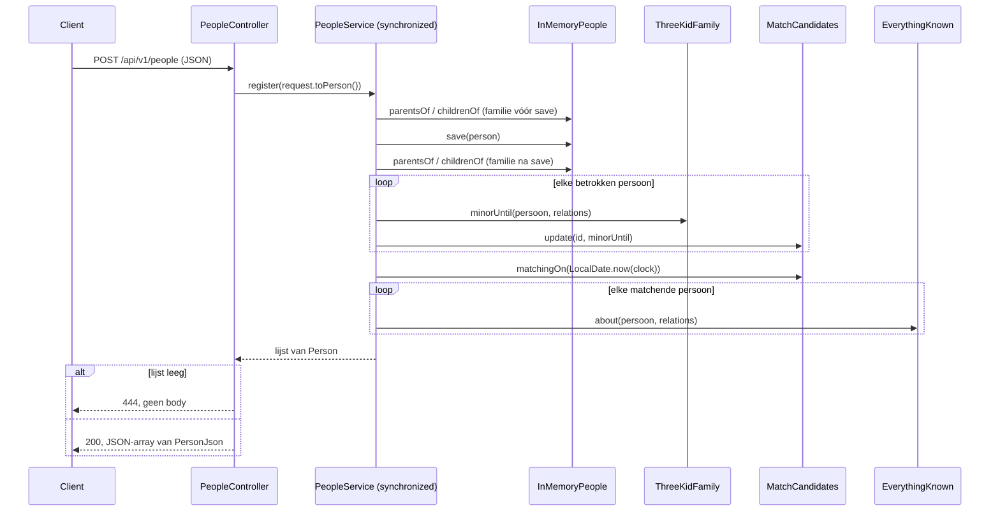
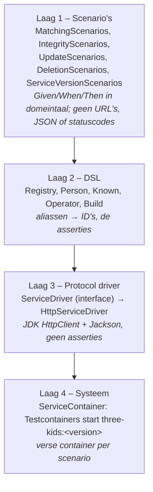
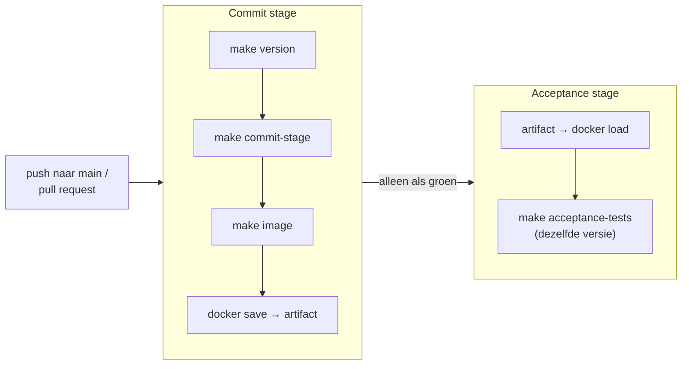

# Technisch ontwerp – Three-Kid Family Challenge

> Voor wie dit project nog nooit heeft gezien en wil begrijpen wat het doet, hoe het in elkaar zit en waarom. Dit document vat de bronnen samen en verwijst ernaar; bij twijfel wint de bron: de code, de tests en de [ADR's](adr/).
>
> Code-, klasse- en domeintermen staan in het Engels, zoals in de code.

## Inhoud

1. [Doel en leeswijzer](#1-doel-en-leeswijzer)
2. [Functionaliteit](#2-functionaliteit)
3. [Context en architectuur](#3-context-en-architectuur)
4. [Domeinmodel](#4-domeinmodel)
5. [Kernmechanismen](#5-kernmechanismen)
6. [Concurrency en consistentie](#6-concurrency-en-consistentie)
7. [Performance](#7-performance)
8. [Teststrategie](#8-teststrategie)
9. [Build, image en pipeline](#9-build-image-en-pipeline)
10. [Werkwijze en Git-historie](#10-werkwijze-en-git-historie)
11. [Beslissingen (ADR-index)](#11-beslissingen-adr-index)
12. [Open punten en risico's](#12-open-punten-en-risicos)
13. [Waar begin je een wijziging](#13-waar-begin-je-een-wijziging)

---

## 1. Doel en leeswijzer

Het project is een uitwerking van de casus [Three-Kid Family Challenge](casus.md): een REST-service die persoonsrecords ontvangt en na **elk** record direct beslist of **iemand** van de opgeslagen personen aan een gezinspatroon voldoet. De service is gebouwd met acceptance test-driven development (ATDD) volgens Dave Farley; die werkwijze bepaalt de vorm van de tests, de commits en de ADR's.

| Bron | Wat je er vindt |
| --- | --- |
| [`casus.md`](casus.md) | De opdracht: patroon, regels, beoordelingscriteria, fase 1 en 2 |
| [`../README.md`](../README.md) | Status, API, waarom ATDD, performance-metingen, open punten, tijdsbesteding |
| [`initial-plan.md`](initial-plan.md) | Het plan, de scenario-backlog met status per item, de domeinkeuzes |
| [`adr/`](adr/) | Elf Architecture Decision Records, elk met een sectie **Guard** (hoe het bewaakt wordt) |
| [`requests.http`](requests.http) | Voorbeeldrequests om de API met de hand te proberen, met het verwachte antwoord |
| [`../CLAUDE.md`](../CLAUDE.md) | Het ATDD-profiel: commando's, paden, conventies en valkuilen |

**Snelle oriëntatie in de code:** begin bij [`PeopleController`](../service/src/main/java/nl/kabulter/threekids/api/PeopleController.java) → [`PeopleService`](../service/src/main/java/nl/kabulter/threekids/application/PeopleService.java) → [`ThreeKidFamily`](../service/src/main/java/nl/kabulter/threekids/domain/ThreeKidFamily.java) en [`InMemoryPeople`](../service/src/main/java/nl/kabulter/threekids/store/InMemoryPeople.java). Voor het gedrag in domeintaal: de scenario's in [`acceptance/.../scenarios/`](../acceptance/src/test/java/nl/kabulter/threekids/acceptance/scenarios/).

---

## 2. Functionaliteit

### 2.1 Het patroon

Een persoon matcht als hij of zij:

1. een partner heeft;
2. **precies 3 kinderen** heeft, die alle drie **die partner** als moeder of vader hebben;
3. waarvan **minstens één onder de 18** is (vandaag, in Europe/Amsterdam).

### 2.2 API

| Request | Body | Antwoord |
| --- | --- | --- |
| `POST /api/v1/people` | Eén persoon (zie hieronder) | **200 OK** met alle personen die nu matchen, met alles wat bekend is; **444 No Response** zonder body als nog niemand matcht |
| `DELETE /api/v1/people` (fase 2) | JSON-array met ID's, bv. `[17, 99, 2137]` | **204 No Content**; de ID's worden verwijderd en voor altijd genegeerd |
| `GET /api/version` | – | `{"version": "<short commit hash>"}`: welke build draait (zie [§9](#9-build-image-en-pipeline)) |

Een persoonsrecord, zoals in de casus; relaties zijn verwijzingen `{ "id": n }` die naar nooit geposte personen mogen wijzen:

```json
{
  "id"       :  42,
  "name"     : "Ada Lovelace",
  "birthDate": "1815-12-10",
  "parent1"  : { "id": 1 },
  "parent2"  : { "id": 2 },
  "partner"  : { "id": 99 },
  "children" : [{ "id": 77 }, { "id": 78 }]
}
```

Regels uit de casus: hetzelfde ID opnieuw posten is een **update** (vervangt het oude record); ouder-kindrelaties zijn **bidirectioneel** ("enforce or auto-repair"); alle filtering in **Java**, geen SQL.

### 2.3 Domeinkeuzes

De casus laat vragen open. Elke keuze is als scenario of unittest vastgelegd en door de gebruiker goedgekeurd ([initial plan, "Domain ambiguities"](initial-plan.md#domain-ambiguities--the-user-approves-each-one-as-a-scenario-before-it-is-built)):

| Vraag | Keuze | Vastgelegd in |
| --- | --- | --- |
| Wie zijn iemands kinderen? | De kinderen die het eigen record noemt **plus** iedereen die deze persoon als `parent1`/`parent2` noemt | ADR 0008, `IntegrityScenarios` |
| Wie zijn iemands ouders? | De ouders in het eigen record **plus** iedereen die deze persoon als kind noemt | ADR 0008 |
| Telt een kind dat alleen op ID bekend is mee voor "precies 3"? | **Nee**: alleen een kind met een eigen record, want leeftijd en tweede ouder zijn nodig | `ThreeKidFamilyTests.aChildKnownOnlyByIdDoesNotCountAsHavingThePartnerAsParent` |
| Kind zonder geboortedatum? | Telt **niet** als onder 18 | `ThreeKidFamilyTests.aChildWithoutABirthDateDoesNotCountAsUnder18` |
| Wanneer is iemand niet meer onder 18? | Op de dag van de 18e verjaardag | `ThreeKidFamilyTests.aChildWhoTurns18TodayIsNoLongerUnder18` |
| Is "partner" symmetrisch? | **Nee** (bewust open): de partner is wat het eigen record zegt | README, "Open points" |
| Wat staat in het 200-antwoord? | Alleen de matchende personen zelf (niet hun partner of kinderen), met alles wat bekend is, **inclusief afgeleide relaties** | Scenario 2, ADR 0009 |
| Wat betekent een verwijzing naar een verwijderd ID? | Het ID is overal **afwezig**: als persoon, ouder, kind en in antwoorden | ADR 0011 |

---

## 3. Context en architectuur

### 3.1 Systeemcontext



Er is geen database, geen message broker en geen andere externe afhankelijkheid. Alle data staat in het geheugen van één proces ([ADR 0005](adr/0005-person-records-in-memory.md)) en is weg na een herstart.

### 3.2 Maven-modules

| Module | Inhoud | Draait in |
| --- | --- | --- |
| [`service`](../service/) | De applicatie en zijn unit-, integratie-, property- en architectuurtests | Commit stage (`make commit-stage`) |
| [`acceptance`](../acceptance/) | Alleen testcode: de acceptatiescenario's in vier lagen tegen de Docker-image | Wordt in de commit stage alleen gecompileerd; draait in de acceptance stage (`-DskipITs=false`) |

De parent [`pom.xml`](../pom.xml) erft van `spring-boot-starter-parent` 4.0.x en beheert de versies van ArchUnit, jqwik en de Jib-plugin.

### 3.3 Pakketten in `service`

Basispakket `nl.kabulter.threekids`. Een port-and-adapters-indeling: het domein definieert de interfaces, de store implementeert ze.



| Pakket | Verantwoordelijkheid |
| --- | --- |
| `api` | HTTP-vertaling: JSON ↔ `Person`, statuscodes 200/444/204. Geen logica. |
| `application` | Use cases `register` en `delete`; bepaalt wie opnieuw geëvalueerd moet worden en houdt de kandidaten bij. Enige plek met `synchronized` op use-case-niveau. |
| `domain` | Het patroon en de regels, als pure Java zonder Spring. Kent een datum, geen klok. |
| `store` | Opslag in het geheugen, met reverse indexes voor de relaties. |
| root | Spring Boot-start en `ClockConfig`, de enige plek die de systeemtijd leest. |

Bewaakt door ArchUnit: alleen `ClockConfig` leest de systeemtijd ([`ArchitectureTests`](../service/src/test/java/nl/kabulter/threekids/architecture/ArchitectureTests.java)). Dat het domein geen Spring gebruikt is waar, maar **nog niet** bewaakt (zie [§12](#12-open-punten-en-risicos)).

---

## 4. Domeinmodel



- **[`Person`](../service/src/main/java/nl/kabulter/threekids/domain/Person.java)** – een record zoals gepost. Relaties zijn ID's; `null` betekent onbekend. Er is geen objectgraaf: een persoon verwijst naar ID's die mogelijk (nog) geen record hebben.
- **[`Relations`](../service/src/main/java/nl/kabulter/threekids/domain/Relations.java)** – read-only view die het patroon nodig heeft. `parentsOf` en `childrenOf` geven de **afgeleide** relaties in beide richtingen, niet alleen wat het eigen record zegt.
- **[`People`](../service/src/main/java/nl/kabulter/threekids/domain/People.java)** – de port voor opslag: `save` vervangt bij een bekend ID, `delete` onthoudt het ID voor altijd. `all()` wordt alleen in tests gebruikt (als referentie in de property test).
- **[`ThreeKidFamily`](../service/src/main/java/nl/kabulter/threekids/domain/ThreeKidFamily.java)** – het patroon. `minorUntil` geeft voor een structurele kandidaat de dag waarop het jongste kind 18 wordt; `isMatchedBy` is de directe check "matcht vandaag", die productie niet gebruikt maar de tests wel als referentie.
- **[`EverythingKnown`](../service/src/main/java/nl/kabulter/threekids/domain/EverythingKnown.java)** – stelt de persoon samen die in het antwoord komt: het geposte record, aangevuld met afgeleide kinderen en ouders.

---

## 5. Kernmechanismen

### 5.1 Opslag en afgeleide relaties ([ADR 0005](adr/0005-person-records-in-memory.md), [ADR 0008](adr/0008-relations-are-derived-in-both-directions.md))

[`InMemoryPeople`](../service/src/main/java/nl/kabulter/threekids/store/InMemoryPeople.java) houdt vier structuren bij, alle `ConcurrentHashMap`-gebaseerd:

| Structuur | Betekenis |
| --- | --- |
| `byId: Map<Long, Person>` | De records **zoals gepost** |
| `namedAsChildBy: Map<Long, Set<Long>>` | kind → wie het als kind noemt |
| `namedAsParentBy: Map<Long, Set<Long>>` | ouder → wie het als ouder noemt |
| `deleted: Set<Long>` | Verwijderde ID's, voor altijd |

`parentsOf(child)` = `namedAsChildBy[child]` ∪ `parent1`/`parent2` uit het eigen record, minus verwijderde ID's. `childrenOf(parent)` werkt spiegelbeeldig. Beide zijn lookups op ID, dus O(1) in het aantal opgeslagen personen.

**Waarom afleiden in plaats van records repareren?** De gekozen "auto-repair" is een *afgeleide view*: wat gepost is blijft gescheiden van wat afgeleid is. Daardoor heeft een update geen undo nodig. Een relatie die alleen afgeleid was, verdwijnt zodra niemand haar nog beweert. Bij `save` van een bekend ID ruimt `forgetClaimsOf` de beweringen van het oude record op voordat die van het nieuwe worden toegevoegd.

Voorbeeld: Bart is gepost zonder ouders; Marge noemt Bart als kind.

```text
byId:            Bart → {parent1: null, parent2: null}, Marge → {children: [Bart]}
namedAsChildBy:  Bart → {Marge}
parentsOf(Bart): {Marge}          ← afgeleid; Barts record blijft ongewijzigd
```

### 5.2 Het patroon: `ThreeKidFamily.minorUntil`



P matcht vandaag als `minorUntil` **na** vandaag ligt. De partner hoeft geen eigen record te hebben; hij of zij moet wel als ouder van elk van de drie kinderen bekend zijn. Let op: de partner van P komt uit **P's eigen record**; daarom kan iemand die alleen op ID bekend is niet matchen.

### 5.3 Incrementeel matchen ([ADR 0010](adr/0010-incremental-matching.md))

Eerst controleerde elke registratie alle opgeslagen personen: O(n) per POST. Nu evalueert een registratie alleen de personen van wie de match kan veranderen:

> Iemands match verandert alleen als het eigen record verandert, als het record van een van de kinderen verandert, of als iemand hem of haar als ouder of kind gaat noemen of niet meer noemt.

Daarom verzamelt `PeopleService.addFamilyOf(id)`: **de persoon, diens ouders en de ouders van diens kinderen**. Dat gebeurt **vóór** `save` (de oude familie, die de persoon kan verliezen) **en na** `save` (de nieuwe familie).

[`MatchCandidates`](../service/src/main/java/nl/kabulter/threekids/application/MatchCandidates.java) houdt de structurele kandidaten bij, gesorteerd op `minorUntil` in een `TreeMap<LocalDate, Set<Long>>`. "Wie matcht vandaag" is dan een range query: `byMinorUntil.tailMap(today, false)`. De leeftijd wordt **nooit** als uitkomst opgeslagen, zodat het antwoord vanzelf klopt als de tijd verstrijkt zonder POST ([ADR 0006](adr/0006-today-comes-from-an-injected-clock.md)).

Een POST van begin tot eind:



**Correctheid** wordt bewaakt door de property test [`IncrementalMatchingProperties`](../service/src/test/java/nl/kabulter/threekids/application/IncrementalMatchingProperties.java): 5.000 willekeurige reeksen van registraties, updates, onbekende verwijzingen en deletes, waarbij na elke registratie het incrementele antwoord gelijk moet zijn aan "iedereen controleren met `isMatchedBy`". De test ving elke sabotage: zonder de ouders, zonder de ouders van de kinderen, alleen na `save`, en zonder het verwijderen van een oude kandidaat.

### 5.4 Tijd ([ADR 0006](adr/0006-today-comes-from-an-injected-clock.md), [ADR 0007](adr/0007-the-date-is-the-date-in-europe-amsterdam.md))

- [`ClockConfig`](../service/src/main/java/nl/kabulter/threekids/ClockConfig.java) levert één `Clock` in zone **Europe/Amsterdam**; de distroless-image draait anders in UTC, en tussen middernacht en 01:00/02:00 zou een kind dan een tot twee uur te lang "onder 18" zijn.
- `PeopleService` bepaalt vandaag met `LocalDate.now(clock)`; het domein krijgt een `LocalDate`, nooit een klok.
- Tests gebruiken `Clock.fixed(...)` en testen beide kanten van de grens (wordt vandaag 18 / morgen 18).
- ArchUnit-regel `onlyClockConfigReadsTheSystemTime` faalt op elke `now()` zonder `Clock`, `Clock.system*()`, `System.currentTimeMillis()` of `new Date()` buiten `ClockConfig`.

### 5.5 Het antwoord ([ADR 0009](adr/0009-the-response-shows-derived-relations.md))

De casus vraagt "everything we know". `EverythingKnown.about` geeft het geposte record terug, aangevuld:

- **kinderen:** eerst de eigen kinderen in geposte volgorde, dan de afgeleide kinderen gesorteerd op ID;
- **ouders:** een lege `parent1`/`parent2` wordt gevuld met een afgeleide ouder (op ID), zonder een al genoemde ouder te herhalen;
- verwijderde of niet meer bekende relaties worden weggelaten;
- naam, geboortedatum en partner zoals gepost.

[`PersonJson`](../service/src/main/java/nl/kabulter/threekids/api/PersonJson.java) vertaalt tussen het JSON-formaat (`{ "id": n }`-verwijzingen) en `Person`. HTTP 444 bestaat niet in Spring's `HttpStatus`, dus de controller gebruikt `ResponseEntity.status(444)`, zonder body.

### 5.6 Verwijderen ([ADR 0011](adr/0011-deleted-ids-are-absent-everywhere.md))

- `PeopleService.delete(ids)` verzamelt per ID eerst de familie (**vóór** het verwijderen, anders zijn de relaties al weg), roept dan `InMemoryPeople.delete(id)` aan en evalueert de familie opnieuw.
- `InMemoryPeople.delete` zet het ID in `deleted`, verwijdert het record en diens beweringen uit de indexes.
- `parentsOf`/`childrenOf` filteren verwijderde ID's altijd weg, ook als andere records ze nog noemen; een verwijderd ID heeft zelf geen relaties.
- `save` van een verwijderd ID doet niets ("ignore for storage"). De POST krijgt gewoon het normale antwoord (200 of 444) voor wie op dat moment matcht.
- Een persoon met een verwijderde partner kan niet meer matchen: geen enkel kind kan die partner nog als ouder hebben.
- `DELETE` met een JSON-body is ongebruikelijk; de HTTP-driver van de acceptatietests stuurt die body expliciet mee.

---

## 6. Concurrency en consistentie

| Plek | Mechanisme | Doel |
| --- | --- | --- |
| `PeopleService.register` / `delete` | `synchronized` | Store en `MatchCandidates` veranderen altijd samen; `MatchCandidates` is zelf niet thread-safe |
| `InMemoryPeople.save` / `delete` | `synchronized` | Record en reverse indexes veranderen samen |
| Leesmethoden van `InMemoryPeople` | Lock-vrij op `ConcurrentHashMap` | Snel lezen; een lezer buiten de service-lock kan een registratie half zien (ADR 0008), maar in productie lopen alle reads via de gesynchroniseerde service |

Gevolg: registraties en deletes worden één voor één verwerkt. Dat is eenvoudig en correct, maar de doorvoer is begrensd door één thread (zie [§7](#7-performance)). Er is geen concurrency-test; die wordt pas zinvol als writes parallel worden ([§12](#12-open-punten-en-risicos)).

---

## 7. Performance

De casus beoordeelt "what your application would do under load". De ontwerpkeuzes daarvoor:

- alles in het geheugen, relaties als lookup op ID ([ADR 0005](adr/0005-person-records-in-memory.md), [ADR 0008](adr/0008-relations-are-derived-in-both-directions.md));
- een registratie evalueert alleen de familie, niet iedereen ([ADR 0010](adr/0010-incremental-matching.md));
- "matcht vandaag" is een range query op een gesorteerde map.

Gemeten met `make perf` (in-process, zonder HTTP; families van vijf; 20 matchers), uit de [README](../README.md#performance):

| Aantal registraties | Vóór ADR 0010: totaal, gemiddeld | Na ADR 0010: totaal, gemiddeld |
| ---: | ---: | ---: |
| 10.000 | 24,8 s, 2.477 µs | 0,3 s, 29,5 µs |
| 20.000 | 99,4 s, 4.971 µs | 0,3 s, 15,3 µs |
| 100.000 | niet gemeten (~40 min geschat) | 1,4 s, 14,1 µs |

Vóór: O(n) per registratie, O(n²) voor een run. Na: constant per registratie, ongeacht het aantal opgeslagen personen.

**Bewaking in de pipeline** (tijd meten op gedeelde CI-runners is onbetrouwbaar, dus wordt het *ontwerp* bewaakt):

- [`PeopleServiceWorkTests`](../service/src/test/java/nl/kabulter/threekids/application/PeopleServiceWorkTests.java): met 1.000 opgeslagen personen evalueert één registratie hooguit 10 kandidaten (geteld via [`CountingPeople`](../service/src/test/java/nl/kabulter/threekids/application/CountingPeople.java)); was rood met "iedereen controleren";
- `IncrementalMatchingProperties`: incrementeel = iedereen controleren.

**Resterende grenzen:**

- het antwoord bevat alle matchers (casus), dus de opbouw groeit met het aantal matchers;
- één write-thread (`synchronized`); HTTP en JSON komen bovenop de ~15 µs;
- het geheugen groeit met het aantal personen, en de `deleted`-set groeit voor altijd (zoals de casus vraagt);
- één instantie met alle data: niet horizontaal schaalbaar zonder een andere store achter de `People`-port.

---

## 8. Teststrategie

De tests ontstaan uit de **double loop** van ATDD: de buitenste lus is een falend acceptatiescenario, de binnenste lus is rood → groen → refactor per klasse, van de controller naar binnen.

### 8.1 Overzicht

| Soort | Klassen | Wat ze vastleggen |
| --- | --- | --- |
| Architectuur (ArchUnit) | [`ArchitectureTests`](../service/src/test/java/nl/kabulter/threekids/architecture/ArchitectureTests.java) | Alleen `ClockConfig` leest de systeemtijd |
| Domein (unit) | [`ThreeKidFamilyTests`](../service/src/test/java/nl/kabulter/threekids/domain/ThreeKidFamilyTests.java), [`EverythingKnownTests`](../service/src/test/java/nl/kabulter/threekids/domain/EverythingKnownTests.java) | Het patroon met alle grensgevallen; samenstelling van het antwoord |
| Store (unit) | [`InMemoryPeopleTests`](../service/src/test/java/nl/kabulter/threekids/store/InMemoryPeopleTests.java) | Afgeleide relaties, vervangen, verwijderen, opnieuw posten van een verwijderd ID |
| Application (unit) | [`PeopleServiceTests`](../service/src/test/java/nl/kabulter/threekids/application/PeopleServiceTests.java), [`PeopleServiceWorkTests`](../service/src/test/java/nl/kabulter/threekids/application/PeopleServiceWorkTests.java) | Use cases met een vaste klok; hoeveelheid werk per registratie |
| Property (jqwik) | [`IncrementalMatchingProperties`](../service/src/test/java/nl/kabulter/threekids/application/IncrementalMatchingProperties.java) | 5.000 reeksen: incrementeel = iedereen controleren |
| Web slice (`@WebMvcTest`) | [`PeopleControllerTests`](../service/src/test/java/nl/kabulter/threekids/api/PeopleControllerTests.java), [`VersionControllerTests`](../service/src/test/java/nl/kabulter/threekids/api/VersionControllerTests.java) | JSON-mapping en statuscodes 200/444/204, met een gemockte `PeopleService` |
| Integratie (`@SpringBootTest`) | [`ThreeKidsApplicationTests`](../service/src/test/java/nl/kabulter/threekids/ThreeKidsApplicationTests.java) | De context start; zonder buildversie meldt de service `dev` |
| Meting (tag `perf`, niet in de pipeline) | [`RegistrationMeasurement`](../service/src/test/java/nl/kabulter/threekids/application/RegistrationMeasurement.java) | Tijd per registratie (`make perf`) |
| Acceptatie | [`scenarios/`](../acceptance/src/test/java/nl/kabulter/threekids/acceptance/scenarios/) | Gedrag in domeintaal tegen de echte Docker-image |

In plaats van mutation testing is elke iteratie met de hand **gesaboteerd** om de test rood te zien; de commitberichten en de Guard-secties van de ADR's noemen per sabotage welke test hem ving.

### 8.2 Het vierlaagse acceptatiemodel ([ADR 0003](adr/0003-acceptance-tests-in-java-with-an-internal-dsl.md))



Een scenario leest als een specificatie ([`MatchingScenarios`](../acceptance/src/test/java/nl/kabulter/threekids/acceptance/scenarios/MatchingScenarios.java)):

```java
// Given Bart, Lisa and Maggie are registered, each with parents Homer and Marge
registry.register(person("Bart").bornOn("1999-04-01").withParents("Homer", "Marge"));
registry.register(person("Lisa").bornOn("2001-05-09").withParents("Homer", "Marge"));
registry.register(person("Maggie").bornOn("2020-01-12").withParents("Homer", "Marge"));

// And Marge is registered with partner Homer and children Bart, Lisa and Maggie
registry.register(person("Marge").bornOn("1978-03-19")
        .withPartner("Homer")
        .withChildren("Bart", "Lisa", "Maggie"));

// Then Marge matches
registry.answersThatTheseMatch("Marge");
```

- **Een verse service per scenario** ([ADR 0004](adr/0004-a-fresh-service-per-scenario.md)): het antwoord hangt af van *alle* opgeslagen personen, dus unieke ID's per scenario isoleren niet. JUnit maakt per testmethode een nieuwe instantie van de scenarioklasse, en die start via `Registry.empty()` (of `new Operator()`) een eigen container; `@AutoClose` stopt hem. Kosten: zo'n 2–3 s per scenario.
- **Geboortedata ver van 18 jaar**: de acceptatietests draaien tegen de echte systeemtijd; de precieze grens wordt in unittests met een vaste klok getest.
- **`ServiceVersionScenarios`** bewijst dat de tests de image van **deze** build testen (zie [§9](#9-build-image-en-pipeline)).

### 8.3 Scenario's en backlog

| Backlog-item ([initial plan](initial-plan.md#scenario-backlog-in-order)) | Scenario | Antwoord |
| --- | --- | --- |
| 0 – walking skeleton | `ServiceVersionScenarios.theServiceReportsTheVersionThatWasBuilt` | versie = commit |
| 1 – geen drie-kindgezin | `MatchingScenarios.aPersonWithoutAThreeKidFamilyDoesNotMatch` | 444 |
| 2 – compleet gezin | `MatchingScenarios.aParentWithAPartnerAndThreeChildrenOneOfThemUnder18Matches` | 200 |
| 3 – alleen volwassen kinderen | `MatchingScenarios.aThreeKidFamilyWithOnlyAdultChildrenDoesNotMatch` | 444 |
| 4 – 2 of 4 kinderen | *gedekt door unittest; 4 kinderen niet getest* | – |
| 5 – andere tweede ouder | `MatchingScenarios.aThreeKidFamilyWhereOneChildHasAnotherSecondParentDoesNotMatch` | 444 |
| 6a – kinderen noemen ouders niet | `IntegrityScenarios.childrenWhoDoNotNameTheirParentsStillCountWhenTheParentsNameThem` | 200 |
| 6b – ouders noemen kinderen niet | `IntegrityScenarios.parentsWhoDoNotNameTheirChildrenStillMatchWhenTheChildrenNameThem` | 200 |
| 7 – update | `UpdateScenarios.aCorrectedBirthDateCanEndAMatch` | 444 |
| 8 – persoon alleen op ID | *open* | – |
| 9 – conflicterende ouders | *open* | – |
| 10a – verwijderen | `DeletionScenarios.aDeletedPersonNoLongerCountsForMatching` | 444 |
| 10b – verwijderd ID opnieuw gepost | `DeletionScenarios.aDeletedPersonWhoIsRegisteredAgainIsIgnored` | 444 |

---

## 9. Build, image en pipeline

### 9.1 Versie en image ([ADR 0002](adr/0002-deployment-pipeline-with-one-image.md))

- **Versie** = de korte commit-hash, met `-dirty` bij niet-gecommitte wijzigingen (`make version`). Die versie is de image-tag (`three-kids:<version>`) en komt via `APP_VERSION` in [`application.yaml`](../service/src/main/resources/application.yaml) terecht, zodat `GET /api/version` hem meldt. Zonder `APP_VERSION` meldt de service `dev`.
- **Image** met **Jib** (geen Dockerfile), op `gcr.io/distroless/java21-debian13:nonroot`, gepind op digest; draait als non-root. Gebouwd voor het platform van de machine (`linux/arm64` op Apple silicon, `linux/amd64` in CI).

### 9.2 Make-targets ([`Makefile`](../Makefile))

| Target | Doet |
| --- | --- |
| `make commit-stage` | `mvnw verify`: unit-, integratie-, property- en architectuurtests; acceptatiemodule alleen compileren |
| `make image` | Jib bouwt `three-kids:<version>` in de lokale Docker-daemon, **zonder tests** |
| `make acceptance-tests` | Draait de scenario's tegen de image van de huidige versie (moet bestaan) |
| `make acceptance` | `image` + `acceptance-tests` |
| `make run` | Bouwt de image en draait hem op http://localhost:8080 |
| `make perf` | De tijdmeting (`PERF_SIZES=10000,100000` voor andere aantallen) |
| `make version` | De versie van de werkboom |

### 9.3 Deployment pipeline ([`.github/workflows/ci.yml`](../.github/workflows/ci.yml))



De image wordt **één keer** gebouwd en de acceptance stage test **precies die image**. Lokaal en in CI worden dezelfde Make-targets gebruikt. Actions zijn op commit-SHA gepind; de workflow heeft alleen `contents: read`. De pipeline is één keer rood gezien (acceptance stage draait dan niet) en daarna groen.

### 9.4 Valkuilen

- `make image` slaat de tests over en `make acceptance-tests` test wat er onder de huidige versie-tag staat. Gebruik na een codewijziging `make acceptance`. De versiecheck vangt een image van een andere commit, maar niet een oudere staat van dezelfde dirty werkboom.
- 444 staat niet in `HttpStatus`: `ResponseEntity.status(444)`.
- "Onder 18" verandert zonder POST: nooit de leeftijdscheck cachen; altijd de geïnjecteerde `Clock`.
- `DELETE /api/v1/people` heeft een JSON-body: controleer bij een nieuwe client dat die echt verstuurd wordt.

---

## 10. Werkwijze en Git-historie

### 10.1 ATDD-iteratie

Elke iteratie volgt de skill [`atdd`](../.claude/skills/atdd/README.md) (in het Nederlands; ongewijzigd overgenomen uit [banksim-mse](https://github.com/edwinbulter/banksim-mse)):

1. ⛔ de mens keurt het scenario en de verwachte waarden goed;
2. het scenario rood zien, om de goede reden;
3. DSL en driver uitbreiden;
4. binnenste lus outside-in: controller → application → domain → store;
5. ⛔ een ADR als een keuze nodig is;
6. commit stage en acceptance stage lokaal groen;
7. ⛔ commit, na toestemming.

Harde regels: één falend scenario tegelijk, geen productiecode zonder falende test, refactoren alleen op groen. Elk commitbericht heeft de koppen **Seen red**, **Sabotage** (indien gedaan) en **Not verified**. De skill [`uitleg`](../.claude/skills/uitleg/SKILL.md) legt een deel van het systeem uit (`/uitleg <onderwerp>`).

### 10.2 Hoe het systeem groeide

`git log --reverse` vertelt het verhaal; elke stap is één kleine commit:

| Fase | Commits |
| --- | --- |
| Opzet | Plan, README, ATDD-profiel en skills |
| Walking skeleton (stap 0) | Service meldt zijn buildversie; pipeline met één image (ADR 0001–0003); verse service per scenario (ADR 0004) |
| Fase 1 – matchen | 444 (scenario 1) → 200 met in-memory store (scenario 2, ADR 0005) → alleen volwassenen met klok en tijdzone (scenario 3, ADR 0006/0007) → andere tweede ouder (scenario 5) |
| Refactors (tussendoor) | `PersonRequest` wordt `PersonJson` (na scenario 1); het patroon leest via de read-only port `Relations` (vóór scenario 6a) |
| Integriteit en update | Afgeleide ouders (6a, ADR 0008); afgeleide kinderen en het antwoord met alles wat bekend is (6b, ADR 0009); update kan een match beëindigen (scenario 7) |
| Performance | Eerst de property test en de meting (`make perf`) op de oude implementatie, dan incrementeel matchen met de work test (ADR 0010), dan `MatchCandidates` uitlichten |
| Fase 2 – verwijderen | DELETE 204 en verwijderde ID's overal afwezig (10a, ADR 0011); opnieuw gepost verwijderd ID wordt genegeerd (10b) |
| Oplevering | `requests.http` voor reviewers; backlogstatus, open punten, tijdsbesteding (5 uur) |

Let op de volgorde bij performance: **eerst** de property test ("incrementeel = iedereen controleren") en de baselinemeting op de oude, simpele implementatie, **daarna** de optimalisatie. De property test bewaakt dat de optimalisatie het gedrag niet verandert; de work test kwam met de optimalisatie mee, omdat hij tegen de oude code rood is (1.001 evaluaties per registratie).

---

## 11. Beslissingen (ADR-index)

| ADR | Beslissing | Guard |
| --- | --- | --- |
| [0001](adr/0001-record-architecture-decisions.md) | Architectuurbeslissingen als ADR (Nygard + sectie Guard), in dezelfde commit als de code | Review |
| [0002](adr/0002-deployment-pipeline-with-one-image.md) | Eén Jib-image per commit; de acceptance stage test precies die image | `ServiceVersionScenarios` |
| [0003](adr/0003-acceptance-tests-in-java-with-an-internal-dsl.md) | Acceptatietests in Java, vier lagen, interne DSL, HTTP-driver | Review; commit stage compileert de module |
| [0004](adr/0004-a-fresh-service-per-scenario.md) | Verse container per scenario | `MatchingScenarios` (444 zou 200 worden op een gedeelde service) |
| [0005](adr/0005-person-records-in-memory.md) | Records in het geheugen achter de port `People` | `InMemoryPeopleTests`, `PeopleServiceTests` |
| [0006](adr/0006-today-comes-from-an-injected-clock.md) | Vandaag komt uit een geïnjecteerde `Clock`; leeftijd nooit opslaan | ArchUnit `onlyClockConfigReadsTheSystemTime` |
| [0007](adr/0007-the-date-is-the-date-in-europe-amsterdam.md) | De datum is die in Europe/Amsterdam | Review (één plek, door ADR 0006) |
| [0008](adr/0008-relations-are-derived-in-both-directions.md) | Ouder-kindrelaties worden in beide richtingen afgeleid; records blijven zoals gepost | `IntegrityScenarios`, `InMemoryPeopleTests` |
| [0009](adr/0009-the-response-shows-derived-relations.md) | Het antwoord toont alles wat bekend is, inclusief afgeleide relaties | `IntegrityScenarios`, `EverythingKnownTests` |
| [0010](adr/0010-incremental-matching.md) | Een registratie evalueert alleen de familie; kandidaten gesorteerd op `minorUntil` | `PeopleServiceWorkTests`, `IncrementalMatchingProperties` |
| [0011](adr/0011-deleted-ids-are-absent-everywhere.md) | Verwijderde ID's zijn overal afwezig; DELETE geeft 204 | `DeletionScenarios`, `InMemoryPeopleTests`, property test |

Nieuwe libraries of tools alleen met een ADR.

---

## 12. Open punten en risico's

### 12.1 Bewust open (uit de [README](../README.md#open-points))

| Punt | Nu | Waarom open |
| --- | --- | --- |
| Partner symmetrisch? (item 8) | Partner = wat het eigen record zegt; iemand die alleen op ID bekend is, kan niet matchen | De casus zegt het niet; eerst een domeinbeslissing |
| Conflicterende ouders (item 9) | Ouders = vereniging van beide richtingen; een derde "ouder" telt mee. In het antwoord passen maar twee ouders (`parent1`/`parent2`); extra afgeleide ouders vallen weg | Domeinbeslissing nodig; nieuwe ADR die 0008 vervangt |
| Vier kinderen (item 4) | "Precies 3" staat in de regel; twee kinderen getest | Een scenario zou direct groen zijn |
| Mutation testing (PIT) | Sabotage met de hand per iteratie | Kost een ADR en tuning; eerste fitness function om toe te voegen |
| Concurrency-test | Writes zijn `synchronized` | Pas zinvol als writes parallel worden |
| ArchUnit: domein zonder Spring | Klopt, maar onbewaakt | Nog niet gedaan |

### 12.2 Technische kanttekeningen (uit de code)

- **Geen persistentie:** alle data, inclusief de lijst verwijderde ID's, is weg na een herstart. "Remember them forever" geldt dus voor de levensduur van het proces.
- **Geen eigen inputvalidatie of foutafhandeling:** er is geen `@Valid` of `@ControllerAdvice`; ongeldige input krijgt het standaardgedrag van Spring, en dat is niet getest.
- **Geen in-process test van de volledige keten voor people:** de `@SpringBootTest` dekt alleen `/api/version`; controller, service en store worden samen alleen door de acceptatietests (tegen de container) getest.
- **Eén instantie, één write-thread:** prima voor de casus; schalen vraagt een andere store achter `People` en een andere aanpak voor `MatchCandidates`.

---

## 13. Waar begin je een wijziging

### 13.1 Proberen

```bash
make run                              # met Docker: bouwt en start de image
./mvnw -pl service spring-boot:run    # zonder Docker
```

Open daarna [`requests.http`](requests.http) in IntelliJ IDEA of VS Code (REST Client) en voer de requests van boven naar beneden uit: de Simpsons worden stap voor stap opgebouwd (444, dan 200 met Marge, dan 200 met Homer en Marge), Maggies geboortedatum wordt aangepast, Maggie wordt verwijderd (204) en opnieuw posten wordt genegeerd.

### 13.2 Waar komt wat

| Wijziging | Waar | Test |
| --- | --- | --- |
| Scenario (laag 1) | `acceptance/src/test/java/.../scenarios/` | JUnit 5 tegen de container |
| DSL (laag 2) | `acceptance/src/test/java/.../dsl/` | via de scenario's |
| Protocol driver (laag 3) | `acceptance/src/test/java/.../drivers/`, `.../drivers/http/` | via de scenario's |
| Domein (patroon, relaties) | `service/src/main/java/.../domain/` (geen Spring) | JUnit, jqwik |
| API en application | `service/src/main/java/.../api`, `.../application` | `@WebMvcTest`; `@SpringBootTest` met MockMvc |
| Opslag | `service/src/main/java/.../store/` | `InMemoryPeopleTests` |
| Architectuurregels | `service/src/test/java/.../architecture/` | ArchUnit |
| Pipeline | `.github/workflows/ci.yml` | één keer rood gezien, dan groen |
| ADR | `doc/adr/NNNN-title.md` | – |

### 13.3 De route voor nieuw gedrag

1. Schrijf het voorbeeld als scenario in domeintaal en laat het goedkeuren (`/atdd next scenario` met Claude Code).
2. Zie het rood in de acceptance stage, om de goede reden: `./mvnw -B -pl acceptance verify -DskipITs=false -Dapp.version=$(make -s version) -Dit.test=<ScenarioClass>` (na `make image`).
3. Werk outside-in met unittests tot het groen is; raakt het matchen, controleer dan dat `IncrementalMatchingProperties` en `PeopleServiceWorkTests` groen blijven en breid de property test uit met nieuwe operaties.
4. Een keuze die verder reikt dan de code zelf uitlegt? Schrijf een ADR met een Guard.
5. `make commit-stage` en `make acceptance` groen, dan één kleine commit met **Seen red**, **Sabotage** en **Not verified**.
